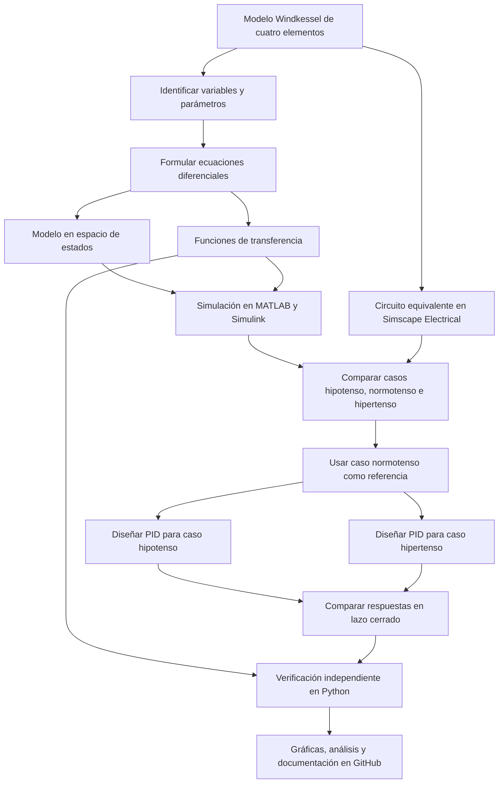

[](https://matlab.mathworks.com/open/github/v1?repo=mildredat/MSFP2)

# Práctica 2: Modelado y control del sistema cardiovascular mediante el modelo Windkessel

Repositorio académico de la asignatura **Modelado de Sistemas Fisiológicos (IBF-1020)**, del programa de **Ingeniería Biomédica** del Tecnológico Nacional de México / Instituto Tecnológico de Tijuana.

Esta práctica aborda el modelado, simulación y control *in silico* del sistema cardiovascular mediante el **modelo Windkessel de cuatro elementos**. Se comparan tres condiciones simuladas —hipotensa, normotensa e hipertensa— y se toma la respuesta normotensa como referencia para diseñar controladores que reduzcan la diferencia entre las respuestas.

**Docente:** Dr. Paul Antonio Valle Trujillo  
**Correo:** paul.valle@tectijuana.edu.mx  
**Departamento:** Ingeniería Eléctrica y Electrónica  
**Institución:** Tecnológico Nacional de México / Instituto Tecnológico de Tijuana  
**Asignatura:** Modelado de Sistemas Fisiológicos  
**Programa:** Ingeniería Biomédica  
**Estudiante:** Nombre completo · Número de control · correo@tijuana.tecnm.mx

**Repositorio de la asignatura:** https://github.com/DrPaulValle/MSF-IBF1020  
**Sede:** Blvd. Alberto Limón Padilla s/n, Tijuana, C. P. 22454, B. C., México.

---

## Contenido

1. [Resumen](#resumen)
2. [Competencia y objetivos](#objetivos)
3. [Fundamento fisiológico y modelo Windkessel](#modelo)
4. [Parámetros de los casos simulados](#parametros)
5. [Modelo matemático](#matematico)
6. [Análisis de estabilidad y error](#estabilidad)
7. [Simulación en MATLAB/Simulink y Simscape](#matlab)
8. [Diseño del control en lazo cerrado](#control)
9. [Implementación en Python](#python)
10. [Resultados y análisis](#resultados)
11. [Flujo de trabajo](#flujo)
12. [Actividades del estudiante](#actividades)
13. [Estructura sugerida del repositorio](#estructura)
14. [Requisitos de software](#requisitos)
15. [Reproducibilidad y entregables](#entregables)
16. [Referencias](#referencias)

---

<a id="resumen"></a>
## 1. Resumen

El objetivo de la práctica es representar la dinámica cardiovascular mediante el modelo Windkessel de cuatro elementos, que considera la impedancia característica proximal \(Z\), la distensibilidad arterial \(C\), la resistencia periférica \(R\) y la inertancia arterial \(L\). La presión se relaciona con el voltaje y el flujo sanguíneo con la corriente, lo que permite formular un modelo matemático a partir de un circuito equivalente.

Se analizan tres conjuntos de parámetros correspondientes a un caso hipotenso, uno normotenso y uno hipertenso. En el material de la práctica, las diferencias entre los casos se representan modificando la distensibilidad arterial \(C\), mientras \(Z\), \(L\) y \(R\) permanecen constantes. El caso normotenso funciona como referencia para comparar las respuestas y diseñar dos sistemas de control independientes, uno para el caso hipotenso y otro para el hipertenso.

La práctica se desarrolla exclusivamente mediante experimentación *in silico*. Se implementan ecuaciones de estado, funciones de transferencia y el circuito equivalente en MATLAB/Simulink/Simscape Electrical. Además, se implementan las funciones de transferencia en Python para verificar de forma independiente las respuestas computacionales.

**Palabras clave:** sistema cardiovascular; modelo Windkessel; hemodinámica; hipotenso; hipertenso; normotenso.

[Volver al contenido](#contenido)

---

<a id="objetivos"></a>
## 2. Competencia y objetivos

### Competencia a desarrollar

Modelizar sistemas fisiológicos mediante circuitos eléctricos equivalentes, ecuaciones diferenciales y funciones de transferencia para analizar su comportamiento dinámico, y diseñar estrategias de control mediante técnicas de control clásico. En esta práctica se analiza el modelo Windkessel de cuatro elementos, se comparan las condiciones hipotensa, normotensa e hipertensa y se diseñan estrategias de control *in silico* para reducir las diferencias entre los casos y la respuesta de referencia.

### Objetivo general

Modelar y simular el sistema cardiovascular mediante el modelo Windkessel de cuatro elementos, comparar la respuesta de los casos hipotenso e hipertenso con la respuesta normotensa y evaluar el desempeño de controladores PID diseñados para reducir el error de seguimiento.

### Objetivos específicos

- Identificar las variables hemodinámicas y los parámetros del modelo Windkessel.
- Relacionar los elementos \(Z\), \(C\), \(R\) y \(L\) con las propiedades del sistema arterial.
- Formular el modelo dinámico mediante ecuaciones diferenciales ordinarias y expresarlo en espacio de estados.
- Obtener las funciones de transferencia de los casos hipotenso, normotenso e hipertenso.
- Analizar el error en estado estacionario y la estabilidad de cada modelo.
- Implementar los tres modelos en MATLAB/Simulink mediante ecuaciones de estado, función de transferencia y circuito equivalente en Simscape Electrical.
- Comparar las respuestas ante una misma señal de excitación aleatoria.
- Diseñar y sintonizar controladores PID para los casos hipotenso e hipertenso usando el caso normotenso como referencia.
- Verificar los resultados mediante una implementación independiente en Python.
- Documentar las gráficas, ganancias de control y conclusiones en el repositorio.

[Volver al contenido](#contenido)

---

<a id="modelo"></a>
## 3. Fundamento fisiológico y modelo Windkessel

El modelo Windkessel representa de manera simplificada las propiedades hemodinámicas del sistema arterial. Su formulación inicial se atribuye a Otto Frank y representaba el sistema arterial mediante una resistencia periférica y una sección distensible. Las versiones posteriores incorporaron la impedancia característica de la región proximal y la inertancia asociada al movimiento de la sangre.

El modelo de **cuatro elementos** utilizado en esta práctica contiene:

| Elemento | Significado fisiológico | Analogía eléctrica |
|---|---|---|
| \(Z\) | Impedancia característica de la región proximal del sistema arterial | Resistencia |
| \(C\) | Distensibilidad arterial total; capacidad de almacenar volumen al distenderse | Capacitancia |
| \(R\) | Resistencia periférica al flujo sanguíneo | Resistencia |
| \(L\) | Inertancia arterial asociada con la masa de sangre en movimiento | Inductancia |

La analogía empleada es:

- **Presión arterial:** voltaje.
- **Flujo sanguíneo:** corriente.
- **Distensibilidad arterial:** capacitancia.
- **Inertancia arterial:** inductancia.
- **Oposición al flujo:** resistencia e impedancia.

### Variables del modelo

| Símbolo | Descripción |
|---|---|
| \(P_a(t)\) | Presión arterial de entrada |
| \(P_p(t)\) | Presión asociada con la distensibilidad arterial; variable de salida |
| \(F_a(t)\) | Flujo dirigido hacia la aorta o arteria pulmonar |
| \(F_L(t)\) | Flujo a través de la inertancia arterial |
| \(F_Z(t)\) | Flujo a través de la impedancia característica |
| \(F_C(t)\) | Flujo asociado con la distensibilidad arterial |
| \(F_R(t)\) | Flujo a través de la resistencia periférica |

El modelo posee cuatro elementos, pero solo dos elementos independientes de almacenamiento de energía: \(L\) y \(C\). Por ello, su dinámica puede describirse mediante dos variables de estado y corresponde a un sistema de segundo orden.

[Volver al contenido](#contenido)

---

<a id="parametros"></a>
## 4. Parámetros de los casos simulados

Los parámetros de referencia indicados en el material de la práctica son:

| Parámetro | Caso hipotenso | Caso normotenso | Caso hipertenso | Unidades |
|---|---:|---:|---:|---|
| \(Z\) | 0.010 | 0.010 | 0.010 | \(\mathrm{mmHg\,s\,ml^{-1}}\) |
| \(L\) | 0.001 | 0.001 | 0.001 | \(\mathrm{mmHg\,s^2\,ml^{-1}}\) |
| \(R\) | 1.000 | 1.000 | 1.000 | \(\mathrm{mmHg\,s\,ml^{-1}}\) |
| \(C\) | 3.500 | 1.500 | 1.000 | \(\mathrm{ml\,mmHg^{-1}}\) |

La diferencia entre los casos se establece modificando únicamente \(C\):

- **Hipotenso:** \(C=3.500\). Una mayor distensibilidad permite almacenar más volumen ante una variación de presión y tiende a atenuar los incrementos de presión.
- **Normotenso:** \(C=1.500\). Se utiliza como modelo de referencia.
- **Hipertenso:** \(C=1.000\). Una menor distensibilidad representa mayor rigidez arterial, por lo que una variación de volumen puede producir cambios de presión más pronunciados.

Los valores anteriores corresponden a los parámetros de simulación definidos en el instructivo y no deben interpretarse como mediciones clínicas de pacientes reales.

[Volver al contenido](#contenido)

---

<a id="matematico"></a>
## 5. Modelo matemático

Se seleccionan como variables de estado el flujo a través de la inertancia y la presión asociada con la distensibilidad arterial:

\[
x_1(t)=F_L(t), \qquad x_2(t)=P_p(t)
\]

La entrada es la presión arterial \(u(t)=P_a(t)\), y la salida es \(y(t)=P_p(t)\).

### Ecuaciones diferenciales ordinarias

Para la inertancia arterial:

\[
P_a(t)-P_p(t)=L\frac{dF_L(t)}{dt}
\]

Por tanto,

\[
\frac{dF_L(t)}{dt}=\frac{1}{L}P_a(t)-\frac{1}{L}P_p(t)
\]

El flujo a través de la impedancia característica es:

\[
F_Z(t)=\frac{P_a(t)-P_p(t)}{Z}
\]

Aplicando conservación del flujo en el nodo de \(P_p(t)\), con \(F_C(t)=C\,dP_p(t)/dt\) y \(F_R(t)=P_p(t)/R\), se obtiene:

\[
\frac{dP_p(t)}{dt}=
\frac{1}{C}F_L(t)+\frac{1}{ZC}P_a(t)
-\left(\frac{1}{ZC}+\frac{1}{RC}\right)P_p(t)
\]

### Representación en espacio de estados

El modelo puede expresarse como:

\[
\dot{x}(t)=Ax(t)+Bu(t), \qquad y(t)=Cx(t)+Du(t)
\]

donde

\[
x(t)=
\begin{bmatrix}
F_L(t)\\
P_p(t)
\end{bmatrix}
\]

\[
A=
\begin{bmatrix}
0 & -1/L\\
1/C & -(1/(ZC)+1/(RC))
\end{bmatrix},
\qquad
B=
\begin{bmatrix}
1/L\\
1/(ZC)
\end{bmatrix}
\]

\[
C=\begin{bmatrix}0&1\end{bmatrix},
\qquad D=0
\]

**Nota:** en la matriz de salida, \(C\) representa la matriz de observación del espacio de estados; en las ecuaciones hemodinámicas, \(C\) representa la distensibilidad arterial. Debe distinguirse su significado según el contexto.

### Función de transferencia

Con condiciones iniciales nulas, obtener la función de transferencia entre la presión arterial de entrada y la presión de salida:

\[
G(s)=\frac{P_p(s)}{P_a(s)}
\]

Se deben determinar por separado \(G_{\mathrm{hipo}}(s)\), \(G_{\mathrm{normo}}(s)\) y \(G_{\mathrm{hiper}}(s)\), sustituyendo los parámetros de cada caso. Las tres funciones son de segundo orden, debido a los dos elementos independientes de almacenamiento de energía, \(L\) y \(C\).

[Volver al contenido](#contenido)

---

<a id="estabilidad"></a>
## 6. Análisis de estabilidad y error

### Error en estado estacionario

Para cada función de transferencia, analizar la respuesta ante una entrada escalón y calcular el valor final y el error en estado estacionario. Comparar los resultados de los casos hipotenso, normotenso e hipertenso. La comparación debe realizarse bajo las mismas condiciones de entrada e inicialización.

### Polos y estabilidad

Calcular los polos de \(G_{\mathrm{hipo}}(s)\), \(G_{\mathrm{normo}}(s)\) y \(G_{\mathrm{hiper}}(s)\). Representarlos en el plano complejo y verificar sus partes reales. Relacionar la localización de los polos con la estabilidad y las diferencias en la respuesta dinámica de cada condición.

### Verificación en MATLAB

El siguiente fragmento muestra cómo definir los parámetros y construir el modelo en espacio de estados. Es una plantilla ilustrativa; las matrices y los resultados deben comprobarse contra la formulación de la práctica.

```matlab
% Parámetros de ejemplo: caso normotenso
Z = 0.010;
L = 0.001;
R = 1.000;
C_art = 1.500; % distensibilidad arterial

A = [0, -1/L;
     1/C_art, -(1/(Z*C_art) + 1/(R*C_art))];

B = [1/L;
     1/(Z*C_art)];

Cout = [0, 1];
D = 0;

sys = ss(A, B, Cout, D);
polos = pole(sys)
```

[Volver al contenido](#contenido)

---

<a id="matlab"></a>
## 7. Simulación en MATLAB/Simulink y Simscape

Para cada condición cardiovascular se implementan tres representaciones:

| Representación | Propósito de verificación |
|---|---|
| Modelo mediante ecuaciones de estado | Comprobar las ecuaciones diferenciales y las variables de estado |
| Modelo mediante función de transferencia | Verificar la relación entrada–salida \(P_a(t)\rightarrow P_p(t)\) |
| Circuito equivalente en Simscape Electrical | Contrastar el comportamiento del circuito con los modelos matemáticos |

### Señal de excitación

En Simulink, utilizar el bloque **Uniform Random Number** con los siguientes parámetros establecidos en el instructivo:

| Parámetro | Valor |
|---|---:|
| Mínimo | 0.2 |
| Máximo | 1 |
| Seed | 106 |
| Tiempo de muestreo \(T_s\) | 0.1 s |
| Intervalo de simulación | \(0\leq t\leq15\) s |

Se debe utilizar **exactamente la misma realización de la señal aleatoria** para los tres modelos. Esto permite atribuir las diferencias entre las respuestas a los parámetros del sistema y no a cambios en la entrada.

### Respuestas que deben registrarse

- Presión de salida del modelo hipotenso: \(P_{p,\mathrm{hipo}}(t)\).
- Presión de salida del modelo normotenso: \(P_{p,\mathrm{normo}}(t)\).
- Presión de salida del modelo hipertenso: \(P_{p,\mathrm{hiper}}(t)\).

Comprobar que las representaciones por ecuaciones de estado, función de transferencia y Simscape producen respuestas consistentes para los mismos parámetros, condiciones iniciales y señal de entrada.

[Volver al contenido](#contenido)

---

<a id="control"></a>
## 8. Diseño del control en lazo cerrado

La respuesta del caso **normotenso** se utiliza como referencia para diseñar dos sistemas de retroalimentación independientes.

### Caso normotenso–hipotenso

El error se define como:

\[
e_{\mathrm{hipo}}(t)=P_{p,\mathrm{normo}}(t)-P_{p,\mathrm{hipo}}(t)
\]

### Caso normotenso–hipertenso

El error se define como:

\[
e_{\mathrm{hiper}}(t)=P_{p,\mathrm{normo}}(t)-P_{p,\mathrm{hiper}}(t)
\]

En cada sistema se incorpora un bloque **PID Controller** de Simulink. Utilizar la herramienta **Tune** para obtener de forma independiente las ganancias:

- Caso hipotenso: \(k_{P,\mathrm{hipo}}\), \(k_{I,\mathrm{hipo}}\) y \(k_{D,\mathrm{hipo}}\).
- Caso hipertenso: \(k_{P,\mathrm{hiper}}\), \(k_{I,\mathrm{hiper}}\) y \(k_{D,\mathrm{hiper}}\).

Ajustar cada controlador buscando una respuesta estable y una reducción del error respecto a la referencia normotensa. Registrar las ganancias finales y guardar evidencia de la configuración utilizada durante la sintonización.

### Comparación en lazo cerrado

Para el caso hipotenso, comparar:

\[
P_{p,\mathrm{normo}}(t),\quad
P_{p,\mathrm{hipo}}(t),\quad
P_{p,\mathrm{hipo,PID}}(t)
\]

Para el caso hipertenso, comparar:

\[
P_{p,\mathrm{normo}}(t),\quad
P_{p,\mathrm{hiper}}(t),\quad
P_{p,\mathrm{hiper,PID}}(t)
\]

Analizar el efecto de cada controlador sobre el seguimiento de la referencia, el error y el comportamiento transitorio. No deben inventarse ganancias: se reportarán los valores obtenidos durante la sintonización.

**Alcance académico:** los controladores de esta práctica se emplean exclusivamente en simulaciones y no constituyen tratamientos ni recomendaciones clínicas para alteraciones de la presión arterial.

[Volver al contenido](#contenido)

---

<a id="python"></a>
## 9. Implementación en Python

Utilizar **Python en Visual Studio Code** para implementar de forma independiente las funciones de transferencia de los modelos hipotenso, normotenso e hipertenso. La implementación debe permitir verificar los resultados obtenidos en MATLAB/Simulink.

Como mínimo, el programa debe:

1. Definir los parámetros \(Z\), \(L\), \(R\) y \(C\) de cada caso.
2. Construir las funciones de transferencia correspondientes.
3. Calcular los polos y analizar la estabilidad.
4. Utilizar la misma señal de excitación que en MATLAB/Simulink.
5. Simular las respuestas de los tres modelos.
6. Incorporar las ganancias PID obtenidas para los dos casos controlados.
7. Graficar las respuestas en lazo abierto y lazo cerrado.
8. Identificar las variables, unidades, leyendas y condiciones de simulación.
9. Guardar las figuras para su inclusión en el reporte.

Las comparaciones entre Python y MATLAB deben utilizar los mismos parámetros, la misma señal de entrada, el mismo intervalo temporal y condiciones iniciales equivalentes. Las bibliotecas indicadas para las prácticas de la asignatura incluyen NumPy, SciPy, Control, Slycot y Matplotlib; comprobar las dependencias concretas del código utilizado.

[Volver al contenido](#contenido)

---

<a id="resultados"></a>
## 10. Resultados y análisis

Organizar los resultados para facilitar la comparación entre las condiciones cardiovasculares y entre las distintas implementaciones.

### Resultados mínimos

- Tabla con los parámetros de los casos hipotenso, normotenso e hipertenso.
- Ecuaciones de estado y funciones de transferencia de los tres casos.
- Tabla de polos y análisis de estabilidad.
- Respuestas en lazo abierto ante la misma señal aleatoria.
- Gráficas comparativas de las tres condiciones.
- Diagramas o capturas de los modelos en Simulink y Simscape Electrical.
- Diagramas de los dos sistemas de control.
- Tabla con las ganancias \(k_P\), \(k_I\) y \(k_D\) obtenidas para cada controlador.
- Gráficas de las respuestas controladas comparadas con la referencia normotensa.
- Comparación de los resultados obtenidos en MATLAB/Simulink y Python.

### Aspectos para discutir

- Cómo influye la distensibilidad arterial \(C\) en la respuesta de presión.
- Diferencias entre los casos hipotenso, normotenso e hipertenso.
- Relación entre los polos y el comportamiento dinámico.
- Reducción del error al incorporar cada controlador PID.
- Consistencia entre las representaciones mediante ecuaciones de estado, función de transferencia y circuito equivalente.
- Posibles diferencias entre MATLAB/Simulink y Python debidas a la implementación numérica o a la configuración de la simulación.
- Limitaciones del modelo simplificado y del alcance exclusivamente computacional de la práctica.

**Importante:** agregar las gráficas, ganancias y observaciones realmente obtenidas. No se deben reportar resultados experimentales físicos, ya que el instructivo establece que esta práctica se desarrolla exclusivamente mediante experimentación *in silico*.

[Volver al contenido](#contenido)

---

<a id="flujo"></a>
## 11. Flujo de trabajo



[Volver al contenido](#contenido)

---

<a id="actividades"></a>
## 12. Actividades del estudiante

- [ ] Identificar \(P_a(t)\), \(P_p(t)\), \(F_a(t)\), \(F_L(t)\), \(F_Z(t)\), \(F_C(t)\) y \(F_R(t)\).
- [ ] Explicar el significado fisiológico de \(Z\), \(C\), \(R\) y \(L\).
- [ ] Formular las ecuaciones diferenciales ordinarias del modelo.
- [ ] Construir la representación en espacio de estados.
- [ ] Obtener \(G_{\mathrm{hipo}}(s)\), \(G_{\mathrm{normo}}(s)\) y \(G_{\mathrm{hiper}}(s)\).
- [ ] Calcular los polos y analizar la estabilidad de los tres modelos.
- [ ] Calcular la respuesta final y el error en estado estacionario ante una entrada escalón.
- [ ] Implementar los modelos en Simulink mediante ecuaciones de estado y función de transferencia.
- [ ] Construir el circuito equivalente en Simscape Electrical.
- [ ] Configurar la señal aleatoria con los parámetros indicados y utilizar la misma realización en los tres casos.
- [ ] Comparar las respuestas de presión en lazo abierto.
- [ ] Diseñar el sistema de control normotenso–hipotenso.
- [ ] Diseñar el sistema de control normotenso–hipertenso.
- [ ] Sintonizar los dos PID y registrar sus ganancias.
- [ ] Comparar las respuestas en lazo cerrado con la referencia normotensa.
- [ ] Implementar y verificar los modelos en Python.
- [ ] Guardar las gráficas y capturas de los modelos.
- [ ] Redactar una discusión de resultados y conclusiones propias.
- [ ] Publicar los archivos finales y la documentación en GitHub.

[Volver al contenido](#contenido)

---

<a id="estructura"></a>
## 13. Estructura sugerida del repositorio

La siguiente estructura es una propuesta para organizar los archivos de la práctica. Ajustar los nombres de acuerdo con los archivos que realmente se hayan desarrollado.

```text
.
├── README.md
├── CITATION.cff
├── Apellido_NoControl.mlx
├── Apellido_NoControl.pdf
├── modelo_windkessel.slx
├── modelo_windkessel.py
├── modelo_windkessel_simscape.slx
├── figuras/
│   ├── parametros_modelos.png
│   ├── polos_modelos.png
│   ├── respuestas_lazo_abierto.png
│   ├── control_hipotenso.png
│   ├── control_hipertenso.png
│   └── comparacion_matlab_python.png
└── evidencias/
    ├── modelo_simulink.png
    ├── circuito_simscape.png
    └── sintonizacion_pid.png
```

Los nombres son sugeridos, no archivos que se afirme que ya existen. Enlazar desde este README únicamente los archivos que se encuentren en el repositorio.

[Volver al contenido](#contenido)

---

<a id="requisitos"></a>
## 14. Requisitos de software

De acuerdo con los recursos generales de la asignatura, se consideran las siguientes herramientas:

- **MATLAB:** análisis numérico y elaboración del cuaderno computacional.
- **Simulink:** modelado mediante diagramas de bloques y sistemas de control.
- **Control Design Toolbox:** diseño y sintonización de controladores.
- **Simscape Electrical:** representación del circuito equivalente.
- **Python y Visual Studio Code:** implementación y verificación independiente.
- **Bibliotecas de Python:** NumPy, SciPy, Control, Slycot y Matplotlib, según las necesidades del programa.
- **GitHub:** control de versiones, documentación y almacenamiento de los archivos de la práctica.

La disponibilidad de funciones depende de las versiones y licencias instaladas. Verificar las dependencias y versiones que se utilizaron al ejecutar los archivos.

[Volver al contenido](#contenido)

---

<a id="entregables"></a>
## 15. Reproducibilidad y entregables

Para que otra persona pueda revisar y reproducir el trabajo, el repositorio debe incluir:

1. El código MATLAB/Python y los modelos de Simulink/Simscape utilizados.
2. Los parámetros de cada caso y la configuración de la señal de excitación.
3. Las ganancias PID obtenidas y la evidencia de sintonización.
4. Las figuras de las respuestas en lazo abierto y lazo cerrado.
5. La comparación de resultados entre MATLAB/Simulink y Python.
6. Una explicación de las diferencias observadas y de las limitaciones del modelo.
7. Las conclusiones del estudiante.

Antes de entregar, comprobar que las rutas de los archivos sean correctas, que las figuras se visualicen desde GitHub y que el README no contenga resultados hipotéticos presentados como si fueran obtenidos.

[Volver al contenido](#contenido)

---

<a id="referencias"></a>
## 16. Referencias

1. Valle, P. A. (2026). *Modelado de Sistemas Fisiológicos* [Syllabus de la asignatura IBF-1020]. Tecnológico Nacional de México, Instituto Tecnológico de Tijuana.
2. Valle, P. A. (2026). *Modelado de Sistemas Fisiológicos* [Repositorio de GitHub]. https://github.com/DrPaulValle/MSF-IBF1020

[Volver al contenido](#contenido)
